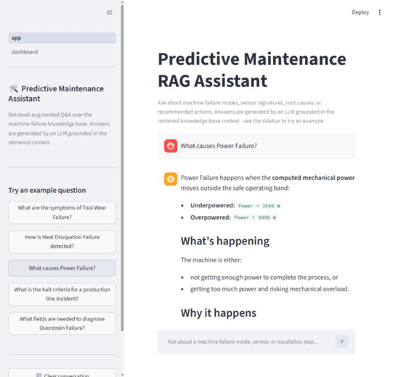
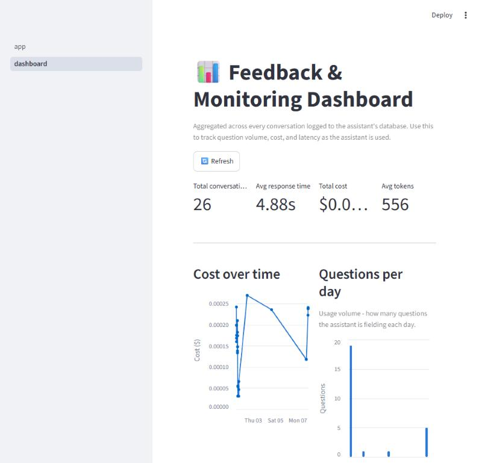

# Predictive Maintenance RAG Assistant


DataTalks LLM Zoomcamp 2026 Capstone Project

A retrieval-augmented Q&A assistant for industrial predictive maintenance. Machine
operators, equipment engineers, and technicians can ask plain-English questions
about equipment failure modes and get an answer grounded in a curated
maintenance knowledge base, generated by an LLM rather than just returning a
raw FAQ match.



## Problem description

Diagnosing an equipment failure quickly usually means digging through FAQ
documents, SOPs, or tribal knowledge scattered across a maintenance team. This
project turns a structured knowledge base — built around the five failure
modes in the [AI4I 2020 Predictive Maintenance dataset](https://archive.ics.uci.edu/dataset/601/ai4i+2020+predictive+maintenance+dataset)
(Tool Wear Failure, Heat Dissipation Failure, Power Failure, Overstrain
Failure, and Random Failure) — into a conversational assistant. Instead of
searching through documents by hand, a user can ask something like *"What
reading range on tool wear usually points to a tool wear failure, and is it a
hard cutoff?"* and get a structured answer (what's happening, why, and the
recommended action) synthesized from the relevant knowledge-base entries.

## Architecture

```
User question
      │
      ▼
Retrieval  (src/search.py)                    TF-IDF vectorization + cosine similarity
      │                                       over question/answer/section/failure_mode/
      │                                       process_control text, fitted once at startup
                                              and cached; top-5 matches
      ▼
Prompt assembly  (src/rag_helper.py)          Retrieved entries formatted into context,
      │                                       injected into a fixed prompt template
      ▼
Generation  (OpenAI Responses API, gpt-5.4-mini)
      │
      ▼
Answer + usage metrics (src/metrics.py)       cost, tokens, response time
      │
      ▼
LLM-as-judge relevance check (src/judge.py)   relevance + groundedness against the retrieved context, in one call; logs its own tokens/cost
      │
      ▼
Streamlit chat UI  (app/app.py)               warns the user when an answer contains unsupported claims  →  Postgres log
```

An LLM-as-judge (`src/judge.py`) scores every generated answer's relevance,
and `app/pages/dashboard.py` / `src/database.py` provide a Postgres-backed
conversation log and monitoring dashboard (see
[Monitoring](#monitoring-dashboard) below).

## Project structure

```
data/
  knowledge_base.json      The initial knowledge base files (kb_001_twf.md, kb_002_hdf.md, kb_003_pwf.md, kb_004_osf.md, kb_005_rnf.md, kb_006_general_sop.md, and kb_007_sensor_reference.md)
                           were generated with the assistance of Claude AI, based on information from the AI4I 2020 Predictive Maintenance Dataset
                           and relevant research papers cited by or related to the dataset.
                           The build_knowledge_base.py script is then used to process these individual knowledge base files and generate the overall knowledge_base JSON file in an FAQ-style format.
                           The UCI page confirms that the AI4I 2020 dataset includes the five failure modes (TWF, HDF, PWF, OSF, and RNF) and provides the associated introductory paper.
                           71 FAQ-style entries across the 5 failure modes
  ground_truth.csv         355 LLM-generated evaluation questions (5 per entry)
  rag_answer.csv           generated answers, prompt/model Approach A
  rag_answer2.csv          generated answers, prompt/model Approach B
  rag_evaluate1.csv        LLM-judge scores for Approach A
  rag_evaluate2.csv        LLM-judge scores for Approach B
  groundedness_eval.csv    judge verdicts, context and unsupported claims for all 355

notebook/
  ground_truth_generation.ipynb   builds ground_truth.csv from the knowledge base
  retrieval_evaluation.ipynb      compares lexical vs. vector-based retrieval
  rag_answer_generation.ipynb     generates answers for two prompt/model approaches
  rag_evaluation.ipynb            LLM-as-judge scoring + approach comparison
  groundedness_evaluation.ipynb   groundedness rate, injection tests, manual-review agreement

src/
  ingest.py         loads the knowledge base, build_index() is the lexical
                    baseline used in retrieval_evaluation.ipynb
  prompt.py         single source of prompts and model names (answer + judge)
  pricing.py        per-model token prices and cost calculation
  search.py         TF-IDF + cosine-similarity retrieval (used in production)
  rag_helper.py     RAGBase: prompt building + OpenAI call
  metrics.py        RAGWithMetrics: production assistant (usage/cost tracking)
  evaluation.py     RAGWithUsage + shared LLM-call / cost-tracking helpers
  judge.py          LLM-as-judge relevance check used live in the chat app
  assistant.py      wires up the winning prompt/model config for the app
  database.py       Postgres schema + conversation/feedback logging

app/
  app.py                  Streamlit chat interface (main entry point)
  pages/
    dashboard.py          monitoring dashboard (cost, latency, volume) -
                           auto-added as a second page/sidebar link by
                           Streamlit's multipage navigation

docs/
  screenshots/          chat.jpg, dashboard.jpg (used in this README)

tests/                 pytest unit tests (mocked OpenAI client, no API key needed)
pytest.ini
.github/workflows/ci.yml   (repo root) runs tests + Docker build on every push
Dockerfile                 builds the app image (Python 3.14)
.dockerignore              keeps .env, notebooks and eval data out of the image
docker-compose.yml         app + Postgres, both started with `docker compose up`
requirements.txt           app dependencies (pinned)
requirements-dev.txt       + Jupyter and pytest for notebooks and tests
```

## Evaluation

### Retrieval evaluation

Two retrieval methods were compared against the full 355-question ground
truth set (`notebook/retrieval_evaluation.ipynb`):

| Method | Hit rate | MRR |
|---|---|---|
| Lexical / boosted keyword search | 0.682 | 0.485 |
| TF-IDF + cosine similarity | **0.879** | **0.700** |

TF-IDF cosine-similarity search was adopted for the production assistant
(`src/search.py`, used by `RAGWithMetrics.search`).

### LLM (answer) evaluation

Two end-to-end answer-generation approaches were each run over all 355
ground-truth questions and scored with an LLM-as-judge
(`good`/`bad`, comparing the generated answer against the ground-truth
answer) in `notebook/rag_evaluation.ipynb`:

| Approach | Prompt | Model | LLM-judge "good" rate |
|---|---|---|---|
| A | Structured (what/why/action, cite mechanism) | gpt-5.4-mini | **82.8%** |
| B | Short/concise | gpt-4o-mini | 79.7% |

Approach A scored higher and is the configuration used in production
(`src/assistant.py`, `src/rag_helper.py`).

### Groundedness evaluation

The relevance judge was extended to also check **groundedness**: whether every
factual claim in an answer is supported by the retrieved context
(`src/judge.py`). Both checks run in a single LLM call.
`notebook/groundedness_evaluation.ipynb` evaluates the production configuration
(Approach A) and validates the judge itself.

**Rubric.** Specific facts (numbers, thresholds, causes, intervals) must appear
in the retrieved context. Generic safety or procedural advice and faithful
rewording are not counted as unsupported. A correct "the context does not
contain enough information" counts as grounded.

| Check | Result |
|---|---|
| Fully grounded answers (355 Approach-A answers) | **93.2%** (6.8% partially grounded, 0% not grounded) |
| Out-of-scope fabricated claims injected into answers | **30/30 caught**, with the injected claim explicitly named in all 30 |
| Numbers in originally grounded answers altered by ~50% | **29/30 caught** |
| Agreement with manual review (random sample of 20, same rubric) | **15/20** |
| Judge cost for all 355 answers | **$0.49** (≈ $0.0014 per answer) |

The two injection tests show the judge reliably detects claims from outside the
knowledge base and clearly wrong numbers. Agreement with manual review is
moderate, so groundedness verdicts are treated as a screening signal for human
review, not as ground truth.

#### Limitations

- **Two variables changed at once.** Approach A and B differ in both prompt and
  model, so the 3.1-point gap can't be attributed to either one alone.
- **Small gap.** 82.8% vs 79.7% on 355 questions is about 11 answers and may be
  within run-to-run variation of the judge.
- **Self-evaluation bias.** The judge (gpt-5.4-mini) is the same model that
  generated Approach A's answers.
- **Retrieval is lexical.** TF-IDF matches on shared terms; it outperformed
  boosted keyword search here, but paraphrased questions with no shared terms
  may retrieve poorly. Comparing against embedding-based and hybrid retrieval
  is a planned next step.
- **Judge validation is small-sample.** Manual agreement was measured on 20
  answers; the altered-number test used a ~50% change, so smaller numeric
  drifts (e.g. 200 → 210) were not tested.
- **Same model family.** The judge (gpt-5.4-mini) also generated the answers it
  evaluates, which may bias it towards accepting its own phrasing.
- **Single-user state.** `last_context` / `last_call` are stored on a shared
  assistant instance: fine for a demo, but concurrent users would need
  per-request state.
  
## Setup

Requires an OpenAI API key. Create a `.env` file in the project root first,
either way you choose to run it below:

```
OPENAI_API_KEY=sk-...
POSTGRES_HOST=localhost
POSTGRES_DB=pm_assistant
POSTGRES_USER=user
POSTGRES_PASSWORD=pswd
```

### Option A: Docker (recommended)

```bash
docker compose up --build -d
```

This builds the app image, starts Postgres, waits for it to be healthy,
initializes the database schema automatically, and starts the Streamlit app
— one command, nothing else to run. Open **http://localhost:8501**.

`docker-compose.yml` runs two services on a shared `monitoring` network:
`postgres` (`postgres:17`, port 5432, with a named `pgdata` volume so data
survives restarts) and `app` (built from the repo's `Dockerfile`, port
8501). The app container talks to Postgres via the `postgres` service name
rather than `localhost` — that override is set directly in
`docker-compose.yml`, so your local `.env`'s `POSTGRES_HOST=localhost` value
(used for Option B below) doesn't need to change.

### Option B: Local Python (3.14)

Needed to run the evaluation notebooks or the test suite.

```bash
python -m venv .venv
source .venv/bin/activate        # .venv\Scripts\activate on Windows
pip install -r requirements-dev.txt
```

Create a `.env` file in the project folder containing `OPENAI_API_KEY=sk-...`,
then start the database and the app:

```bash
docker compose up -d postgres
streamlit run app/app.py
```

The app creates and migrates its database schema on startup, so no separate
initialisation step is needed.

## Testing & CI

Unit tests cover retrieval ranking, prompt construction, cost calculation,
LLM call logging, model configuration and the relevance judge. LLM calls use a
fake OpenAI client, so tests are fast, free and need no API key.

```bash
pip install -r requirements-dev.txt
pytest -v
```

GitHub Actions (`.github/workflows/ci.yml`) runs the test suite and then
builds the Docker image on every push and pull request.

## Reproducing the evaluation

Run the notebooks in this order from the `notebook/` directory:

1. `ground_truth_generation.ipynb` — generates `data/ground_truth.csv`
2. `retrieval_evaluation.ipynb` — compares retrieval methods
3. `rag_answer_generation.ipynb` — generates `rag_answer.csv` / `rag_answer2.csv`
   for both prompt/model approaches
4. `rag_evaluation.ipynb` — LLM-judges both answer sets and compares them

Each notebook adds the project root to `sys.path` and expects to be run with
its working directory set to `notebook/`.

## Monitoring dashboard



`app/pages/dashboard.py` (reachable via the sidebar link inside the running
app) reads conversation history from Postgres (`src/database.py`) and shows
total conversations, average response time, total cost, average tokens,
question volume per day, a prompt-vs-completion token breakdown, and
cost/latency trends over time.

Every question asked in `app/app.py` is logged to the `conversations` table
(`save_conversation`), along with an automatic LLM-as-judge relevance verdict
and the user's own 👍/👎 feedback (`save_feedback`) — so the dashboard
reflects real usage as soon as the app is used, with no extra setup beyond
the Postgres steps above.
The judge's own token usage and cost are logged alongside its verdict, so the dashboard reports the true cost per question (answer + evaluation), not just the answer call.

The dashboard also shows answer quality: the share of fully grounded answers
and the distribution of groundedness verdicts. In the chat, any answer the
judge marks as partially or not grounded is shown with a warning listing the
specific claims to verify before acting on them.

## Version history

- **v1.0-zoomcamp-submission**: capstone as submitted for peer review.
- **v1.1-hardened**: production hardening: cached retriever, centralised
  prompts and pricing, judge cost tracking, structured logging, fail-fast
  database initialisation, unit tests and CI, slimmer Docker image.
- **v1.2-groundedness**: context-groundedness judge with in-app warnings,
  dashboard quality metrics and a validated offline evaluation.
  
## License

© 2026 Octavia May. All rights reserved.

This code is shared publicly for portfolio review only. You may view it,
but you may not copy, reuse, modify, or redistribute any part of it
without my written permission. See [LICENSE](LICENSE) for details.
